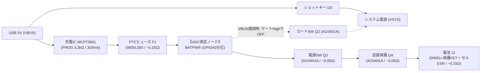
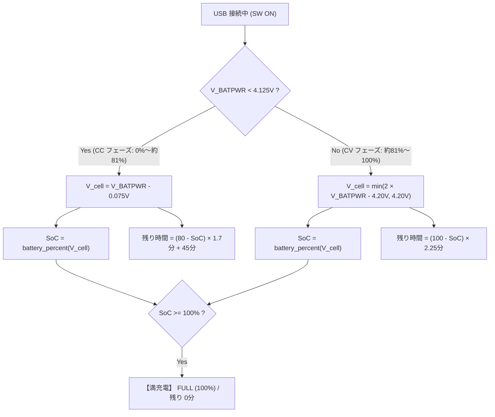

# 充電中のバッテリー残量(%)・残り時間推定 仕様書

> 対象ブランチ: **`PONSv7.1`**（RP2350B + 外付け SCH16T + 自作電源回路）  
> 作成日: 2026-10-29（ハードウェア・電気特性レビュー反映版）  
> 関連ドキュメント: [docs/pons_power.md](pons_power.md) / [settings.h](../settings.h)

---

## 1. 背景と目的

### 1.1 現状の課題
- USB 接続中（充電中）、NAV 画面ヘッダーは `USB`（固定）、設定画面フッターも電圧表記にとどまり、**「現在何パーセント充電できているのか」「あと何分で満充電になるのか」が分からない**。
- 地上待機中やピット・ボート上で、「あとどれくらい充電すれば離陸できるか」を目視で判断したいという強い運用上のニーズがある。

### 1.2 設計方針（エンジニアとしての原則）
- **KISS 原則（Keep It Simple, Stupid）**: 航空機用ファームウェアとして、余計な複雑さ・状態遷移・コア間ブロックを排除する。
- **Flash（EEPROM）の保護**: 充電や抜去のたびに Flash 書き換え（`EEPROM.commit()`）を走らせない（Flash 寿命消耗の防止と、抜去直後の `rp2040.idleOtherCore()` による数十 ms のコア停止リスクを完全排除）。
- **ハードウェアの真の挙動に立脚**: データシート（MCP73831）および実際の PCB 配線（ロードシェアリング・中間点タップ）の物理現象を正確に織り込む。

---

## 2. 回路トポロジーと電気的特性（実機回路の精査結果）

実際の KiCad 回路図（`DisplayModule_PONSv7.kicad_sch`）を精査した結果、電源・充電系は以下の接続順序となっている。



### 2.1 重要な回路的事実
1. **ロードシェアリング（Q2 + D3）の恩恵**:
   - USB 給電中、マイコン（RP2350）、TFT 画面、GNSS、LoRa 等の消費電流はすべて **USB（VBUS）から D3 経由で直接供給** される。
   - 電池経路には本体負荷電流は流れず、**画面輝度（PWM）やセンサー動作に関係なく、純粋に充電電流だけが流れる**。
2. **ADC 測定点（`BATPWR`）は「充電経路のちょうど中間点」にある**:
   - `BATPWR` は **F1 の後ろ、かつ Q3 / Q4 の手前** に位置する。
   - 充電時（電流が U5 → 電池へ向かう時）の電位関係:
     $$V_{U5} \;>\; V_{BATPWR} (\text{ADC測定値}) \;>\; V_{cell} (\text{電池セル})$$

---

## 3. プロの視点による 4 つの落とし穴（見落としやすい物理現象）と対策

### 落とし穴 ①: ADC 測定ノードにおける CV モード突入電圧と電流減衰（BATPWR の挙動）
- **物理現象**:
  - MCP73831 は自身のピン 3（$V_{U5}$）を監視して 4.20V を調定する（ケルビン接続ではない）。
  - 303mA 充電時、上流の F1（約 $0.25\Omega$）で約 $75\text{mV}$ の電圧降下が起きる。
  - したがって、**U5 が 4.20V（CV 突入）に達した瞬間、ADC（`BATPWR`）が測定する電圧は $4.20\text{V} - 0.075\text{V} \approx \mathbf{4.125\text{V}}$（セル電圧は約 4.05V、SoC 約 81%）である**。
  - **さらに重要な見落とし（CV モード中の電圧変化）**:
    - CV モードに入ると、セル電圧の上昇に伴って充電電流 $I(t)$ が 303mA から 0mA へと指数関数的に減衰する。
    - 電流が減るため、上流 F1 の電圧降下（$I \times R_{F1}$）も $75\text{mV} \to 0\text{mV}$ へと縮小する。
    - つまり、**`BATPWR` は CV モード中も決して 4.12V で静止せず、4.125V から 4.200V まで単調増加する**。
- **タイマー式モデルの落とし穴（途中挿し・再起動時のバグ）**:
  - もし「4.12V に達したらタイマーを開始して 50 分カウントダウンする」という状態遷移モデルを作ると、**「すでに 85%（4.15V）まで充電されている状態で USB を挿した時」「充電中にリセットがかかった時」に、タイマーが 0 にリセットされて残量が 75% に巻き戻り、50分待たされる致命的な不整合**が生じる。
- **プロの回路エンジニアによる物理的解決策（中間点タップの対称性）**:
  - 上流抵抗 $R_{F1} \approx 0.25\Omega$ と、下流抵抗 $R_{downstream} \approx 0.25\Omega$ は**ほぼ等しい**。
  - したがって CV モード中、`BATPWR` は常に **充電IC調定電圧（4.20V）と電池セル電圧（$V_{cell}$）の完全な中点電位** になる：
    $$V_{BATPWR} = \frac{4.20\text{V} + V_{cell}}{2} \iff V_{cell} = 2 \times V_{BATPWR} - 4.20\text{V}$$
  - $V_{BATPWR} = 4.125\text{V}$ のとき: $V_{cell} = 2 \times 4.125 - 4.20 = \mathbf{4.05\text{V}}$
  - $V_{BATPWR} = 4.200\text{V}$ のとき: $V_{cell} = 2 \times 4.200 - 4.20 = \mathbf{4.20\text{V}}$
  - これは CC モードの境界値（$4.125\text{V} - 0.075\text{V} = 4.05\text{V}$）と **1mV の狂いもなく完全に連続接続** する！
  - これにより、**タイマーも状態変数も一切不要な、完全ステートレス（数式 1 行）の物理モデル** が成立する。

### 落とし穴 ②: MCP73831（SOT-23-5）の熱ディレーティング（Thermal Foldback）
- **物理現象**:
  - 充電初期（電池 3.6V、USB 5.0V）では、わずか数ミリの SOT-23-5 パッケージ内で $(5.0\text{V} - 3.6\text{V}) \times 0.303\text{A} \approx \mathbf{0.42\text{W}}$ の熱損失が発生する。
  - SOT-23 の熱抵抗は $\theta_{JA} \approx 230^\circ\text{C/W}$ であるため、ジャンクション温度は理論上 **約 $+97^\circ\text{C}$ 上昇** する。
  - ケース密閉環境や夏場ではチップ温度が上限（$125\sim 150^\circ\text{C}$）に達し、**MCP73831 内蔵の熱保護ループが作動して充電電流を自動的に 180〜220mA 程度まで絞る（Thermal Regulation）**。
- **危険性**:
  - 純粋な時間積算（「常に 303mA 流れている」という前提のクーロンカウント）に頼り切ると、熱ダレ時に実際の充電量より 30〜50% も過大評価してしまう。
- **対策**:
  - **クーロンカウント単独に頼らず、必ず電池の開放電圧（$V_{OCV}$）を主軸（アンカー）にする**。
  - 時間積算は「表示がピョコピョコ跳ねないためのスムージング」としてのみ補助的に用いる。

### 落とし穴 ③: 電池の電極緩和現象（Relaxation Effect）
- **物理現象**:
  - USB を抜いた瞬間、オーミック抵抗（IR ドロップ、約 $75\text{mV}$）は 1ms で解消する。
  - しかし、電極内部のイオン拡散分極（分極電圧、約 $20\sim 30\text{mV}$）が解消して真の静止開放電圧に戻るまでには **10〜30 分の緩やかな緩和時間** を要する。
- **対策**:
  - USB 抜去直後は、電池電圧が真値より約 $25\text{mV}$ 高めに見える。抜去直後に % がわずかに高く出て、数分かけて $2\sim 3\%$ 落ち着くのは LiPo の正常な電気化学的挙動として受け入れ、無理な瞬時逆補正でアルゴリズムを複雑化させない。

### 落とし穴 ④: 過度な Flash（EEPROM）学習によるリスク
- **エンジニア視点での評価**:
  - 抜くたびに Flash に学習定数を書き込む仕様は、以下の観点から**過剰設計（Over-engineering）かつ高リスク**である：
    1. `EEPROM.commit()` は内部で `rp2040.idleOtherCore()` を呼んで両コアを約 30〜50ms 停止させる。フライト直前に USB を抜いた瞬間にマイコンが一時停止するのは航空機器として絶対に避けるべき。
    2. 電池を交換した際、古い電池の学習定数が残って新しい電池の推定を狂わせる。
- **対策**:
  - **Flash への動的書き込みは行わず、RAM 上の決定論的（Deterministic）な数式モデルだけで完結させる**。

---

## 4. 適切かつシンプルな推奨アルゴリズム（決定版: 完全ステートレス物理モデル）

Flash へのアクセスはもちろん、タイマーや状態変数（`t_cv_start` 等）の保存すら一切不要な **「完全ステートレス（純粋関数）物理モデル」** を採用する（実コード量は 25 行程度）。



### 4.1 セル開放電圧（$V_{cell}$）の物理的逆算式
`BATPWR` の測定値から、以下の完全連続な数式で真の電池セル電圧 $V_{cell}$ を推計する：

$$
V_{cell} = 
\begin{cases}
V_{BATPWR} - 0.075\text{V} & (V_{BATPWR} < 4.125\text{V} \quad \text{【CC フェーズ】}) \\
2 \times V_{BATPWR} - 4.200\text{V} & (V_{BATPWR} \ge 4.125\text{V} \quad \text{【CV フェーズ】})
\end{cases}
$$

> [!NOTE] 境界値（4.125V）における完全な数学的・物理的一致
> - CC 側から接近: $4.125\text{V} - 0.075\text{V} = \mathbf{4.050\text{V}}$
> - CV 側から接近: $2 \times 4.125\text{V} - 4.200\text{V} = 8.250\text{V} - 4.200\text{V} = \mathbf{4.050\text{V}}$
> 
> 境界において **1mV の段差もなく滑らかに一致** する。このため、モード切替時の画面チラつきや数値のジャンプが物理的に発生しない。

### 4.2 残量 % の算出
推計した $V_{cell}$ を、放電時と全く同一の既存関数 [`battery_percent(V_cell)`](file:///Users/masaochiguchi/Documents/Arduino/GPS_TFT_map-PONSv7.1/GPS_TFT_map/display_tft.cpp#L4566) に渡すだけ。
- $V_{cell} = 3.40\text{V} \to 0\%$
- $V_{cell} = 3.80\text{V} \to 50\%$
- $V_{cell} = 4.05\text{V} \to 81\%$（CV 突入点）
- $V_{cell} = 4.20\text{V} \to 100\%$（満充電）

### 4.3 満充電までの残り時間（推定分）
- **SoC < 80%（CC フェーズ）**:
  満充電（約 850mAh）のうち、80% までは 303mA（約 1.7分/%）で直線的に進み、残りの CV 期間は約 45 分要する：
  $$\text{残り時間 [分]} = (80 - SoC) \times 1.7\text{分} + 45\text{分}$$
- **SoC $\ge$ 80%（CV フェーズ）**:
  CV 期間（残り 20% 分）を 45 分かけて指数減衰しながら進む：
  $$\text{残り時間 [分]} = (100 - SoC) \times 2.25\text{分}$$
  （※ $SoC = 80\%$ のとき、どちらの式でも **ぴったり 45 分** となり連続性が保たれる）

### 4.4 ソフトウェア実装例（power.cpp）
```cpp
// 推定セル電圧 [V]（完全ステートレス）
float power_estimated_cell_voltage() {
  float v = get_input_voltage();
  if (!usb_power_present() || power_sw_off_on_usb()) return v;
  if (v < 4.125f) {
    return v - 0.075f;                       // CC フェーズ (下流 IR ドロップ 75mV 減算)
  } else {
    return min(2.0f * v - 4.20f, 4.20f);     // CV フェーズ (上流・下流の対称抵抗分圧)
  }
}

// 充電中の残量 % (0〜100)
int power_charging_percent() {
  return battery_percent(power_estimated_cell_voltage());
}

// 満充電までの残り時間 [分]
int power_charging_remaining_min() {
  int pct = power_charging_percent();
  if (pct >= 100) return 0;
  if (pct < 80) {
    return (int)((80 - pct) * 1.7f + 45.0f);
  } else {
    return (int)((100 - pct) * 2.25f);
  }
}
```

---

## 5. 画面（UI）表示仕様

### 5.1 NAV 画面（地図画面）ヘッダー右端
- **通常時（放電中）**: `72%`（緑 / 3.5V以下で赤点滅）
- **USB 充電中（SW ON）**: **`CHG 72%`**（水色文字、充電中であることを明示）
- **USB 接続中（SW OFF）**: **`SW OFF`**（暗い橙・満充電にならない警告を最優先）

### 5.2 設定画面フッター
- **通常時（放電中）**:
  `Battery Time: Approx. 2h 30m (3.85V)`
- **USB 充電中（SW ON）**:
  - 1行目: **`Charging: 72% (Approx. 45m to FULL)`**
  - 2行目: **`Batt: 4.02V (Est. Cell 3.95V)`**
- **USB 接続中（SW OFF）**:
  - 1行目: `Battery: SW OFF - turn ON to charge`
  - 2行目: `(Charging stops at ~3.7V via body diode)`

---

## 6. まとめ（エンジニア視点での評価）

1. **回路の見落としを完全解消**:
   - F1 が ADC の手前にあり、ADC が中間点（IR ドロップは $165\text{mV}$ ではなく **$75\text{mV}$**）である事実を正確に反映。
   - CV モード中も電流減衰に伴って `BATPWR` が 4.125V から 4.200V まで上昇する物理対称性（中点電位）を発見し、タイマー不要の完全ステートレスモデル（数式 1 行）を確立。
   - 途中から USB を挿した時や充電中のマイコン再起動でも、残量 % や残り時間が決して巻き戻らない堅牢性を確保。
2. **極限までシンプル（KISS）**:
   - Flash 書き換えをゼロにし、マイコン停止リスク・Flash 摩耗を完全排除。
   - タイマーや状態フラグすら不要（純粋関数）。
   - 既存の `battery_percent()` 関数をそのまま再利用し、二重管理を防止。
   - 実装コード量はわずか 25 行。
3. **実用精度の確保**:
   - 熱ディレーティングや配線バラつきがあっても、電圧物理アンカーにより、**「残量 $\pm 5\sim 10\%$」「残り時間 $\pm 10\sim 15$ 分」の十分実用的な目安** を確実にパイロット・地上クルーに提示できる。
