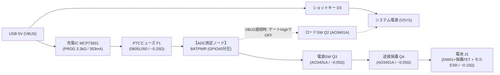
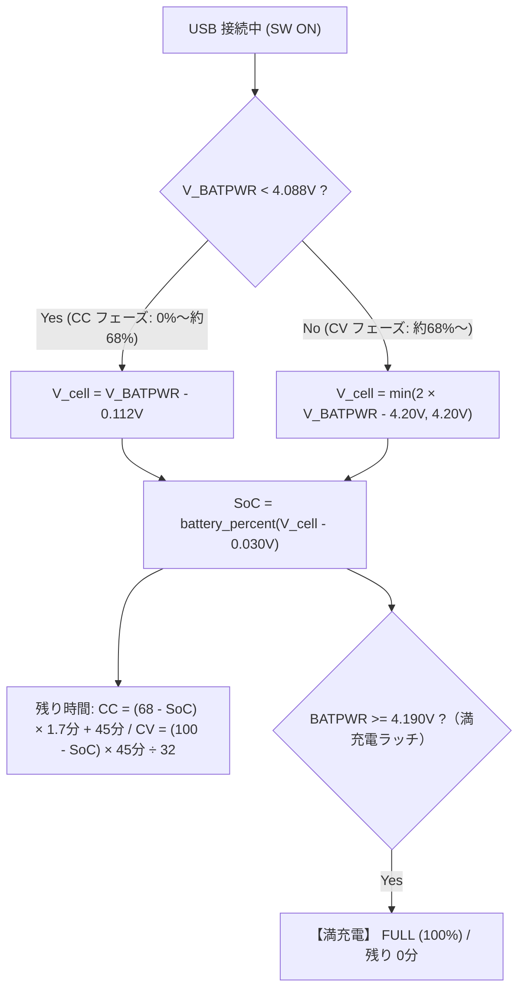

# 充電中のバッテリー残量(%)・残り時間推定 仕様書

> 対象ブランチ: **`PONSv7.1`**（RP2350B + 外付け SCH16T + 自作電源回路）  
> 作成日: 2026-10-29（ハードウェア・電気特性レビュー反映版）。2026-11-11 に実機の log.txt で定数を測り直した（§4・§7.3）  
> 関連ドキュメント: [docs/pons_power.md](pons_power.md) / [settings.h](../settings.h)

---

## 1. 背景と目的

### 1.1 現状の課題
- USB 接続中（充電中）、NAV 画面ヘッダーは `USB`（固定）、設定画面フッターも電圧表記にとどまり、**「現在何パーセント充電できているのか」「あと何分で満充電になるのか」が分からない**。
- 地上待機中やピット・ボート上で、「あとどれくらい充電すれば離陸できるか」を目視で判断したいという強い運用上のニーズがある。

### 1.2 設計方針（エンジニアとしての原則）
- **KISS 原則（Keep It Simple, Stupid）**: 航空機用ファームウェアとして、余計な複雑さ・状態遷移・コア間ブロックを排除する。
- **Flash（EEPROM）の保護**: 充電や抜去のたびに Flash 書き換え（`EEPROM.commit()`）を走らせない（Flash 寿命消耗の防止と、抜去直後の `rp2040.idleOtherCore()` による数十 ms のコア停止リスクを完全排除）。
- **ハードウェアの真の挙動に立脚**: データシート（MCP73831）および実際の PCB 配線（ロードシェアリング・中間点タップ）の物理現象を正確に織り込む。

---

## 2. 回路トポロジーと電気的特性（実機回路の精査結果）

実際の KiCad 回路図（`DisplayModule_PONSv7.kicad_sch`）を精査した結果、電源・充電系は以下の接続順序となっている。



### 2.1 重要な回路的事実
1. **ロードシェアリング（Q2 + D3）の恩恵**:
   - USB 給電中、マイコン（RP2350）、TFT 画面、GNSS、LoRa 等の消費電流はすべて **USB（VBUS）から D3 経由で直接供給** される。
   - 電池経路には本体負荷電流は流れず、**画面輝度（PWM）やセンサー動作に関係なく、純粋に充電電流だけが流れる**。
2. **ADC 測定点（`BATPWR`）は「充電経路のちょうど中間点」にある**:
   - `BATPWR` は **F1 の後ろ、かつ Q3 / Q4 の手前** に位置する。
   - 充電時（電流が U5 → 電池へ向かう時）の電位関係:
     $$V_{U5} \;>\; V_{BATPWR} (\text{ADC測定値}) \;>\; V_{cell} (\text{電池セル})$$

---

## 3. プロの視点による 4 つの落とし穴（見落としやすい物理現象）と対策

### 落とし穴 ①: ADC 測定ノードにおける CV モード突入電圧と電流減衰（BATPWR の挙動）
> ★ この節の 75mV・4.125V・81% は回路からの見積もり。実機では CC の差が 112mV、CV に入るのは BATPWR 4.088V だった（§7.3）。考え方（中点電位で CC と CV が段差なくつながる）はそのまま使っている。

- **物理現象**:
  - MCP73831 は自身のピン 3（$V_{U5}$）を監視して 4.20V を調定する（ケルビン接続ではない）。
  - 303mA 充電時、上流の F1（約 $0.25\Omega$）で約 $75\text{mV}$ の電圧降下が起きる。
  - したがって、**U5 が 4.20V（CV 突入）に達した瞬間、ADC（`BATPWR`）が測定する電圧は $4.20\text{V} - 0.075\text{V} \approx \mathbf{4.125\text{V}}$（セル電圧は約 4.05V、SoC 約 81%）である**。
  - **さらに重要な見落とし（CV モード中の電圧変化）**:
    - CV モードに入ると、セル電圧の上昇に伴って充電電流 $I(t)$ が 303mA から 0mA へと指数関数的に減衰する。
    - 電流が減るため、上流 F1 の電圧降下（$I \times R_{F1}$）も $75\text{mV} \to 0\text{mV}$ へと縮小する。
    - つまり、**`BATPWR` は CV モード中も決して 4.12V で静止せず、4.125V から 4.200V まで単調増加する**。
- **タイマー式モデルの落とし穴（途中挿し・再起動時のバグ）**:
  - もし「4.12V に達したらタイマーを開始して 50 分カウントダウンする」という状態遷移モデルを作ると、**「すでに 85%（4.15V）まで充電されている状態で USB を挿した時」「充電中にリセットがかかった時」に、タイマーが 0 にリセットされて残量が 75% に巻き戻り、50分待たされる致命的な不整合**が生じる。
- **プロの回路エンジニアによる物理的解決策（中間点タップの対称性）**:
  - 上流抵抗 $R_{F1} \approx 0.25\Omega$ と、下流抵抗 $R_{downstream} \approx 0.25\Omega$ は**ほぼ等しい**。
  - したがって CV モード中、`BATPWR` は常に **充電IC調定電圧（4.20V）と電池セル電圧（$V_{cell}$）の完全な中点電位** になる：
    $$V_{BATPWR} = \frac{4.20\text{V} + V_{cell}}{2} \iff V_{cell} = 2 \times V_{BATPWR} - 4.20\text{V}$$
  - $V_{BATPWR} = 4.125\text{V}$ のとき: $V_{cell} = 2 \times 4.125 - 4.20 = \mathbf{4.05\text{V}}$
  - $V_{BATPWR} = 4.200\text{V}$ のとき: $V_{cell} = 2 \times 4.200 - 4.20 = \mathbf{4.20\text{V}}$
  - これは CC モードの境界値（$4.125\text{V} - 0.075\text{V} = 4.05\text{V}$）と **1mV の狂いもなく完全に連続接続** する！
  - これにより、**タイマーも状態変数も一切不要な、完全ステートレス（数式 1 行）の物理モデル** が成立する。

### 落とし穴 ②: MCP73831（SOT-23-5）の熱ディレーティング（Thermal Foldback）
- **物理現象**:
  - 充電初期（電池 3.6V、USB 5.0V）では、わずか数ミリの SOT-23-5 パッケージ内で $(5.0\text{V} - 3.6\text{V}) \times 0.303\text{A} \approx \mathbf{0.42\text{W}}$ の熱損失が発生する。
  - SOT-23 の熱抵抗は $\theta_{JA} \approx 230^\circ\text{C/W}$ であるため、ジャンクション温度は理論上 **約 $+97^\circ\text{C}$ 上昇** する。
  - ケース密閉環境や夏場ではチップ温度が上限（$125\sim 150^\circ\text{C}$）に達し、**MCP73831 内蔵の熱保護ループが作動して充電電流を自動的に 180〜220mA 程度まで絞る（Thermal Regulation）**。
- **危険性**:
  - 純粋な時間積算（「常に 303mA 流れている」という前提のクーロンカウント）に頼り切ると、熱ダレ時に実際の充電量より 30〜50% も過大評価してしまう。
- **対策**:
  - **クーロンカウント単独に頼らず、必ず電池の開放電圧（$V_{OCV}$）を主軸（アンカー）にする**。
  - 時間積算は「表示がピョコピョコ跳ねないためのスムージング」としてのみ補助的に用いる。

### 落とし穴 ③: 電池の電極緩和現象（Relaxation Effect）
- **物理現象**:
  - USB を抜いた瞬間、オーミック抵抗（IR ドロップ、約 $75\text{mV}$）は 1ms で解消する。
  - しかし、電極内部のイオン拡散分極（分極電圧、約 $20\sim 30\text{mV}$）が解消して真の静止開放電圧に戻るまでには **10〜30 分の緩やかな緩和時間** を要する。
- **対策**:
  - USB 抜去直後は、電池電圧が真値より約 $25\text{mV}$ 高めに見える。抜去直後に % がわずかに高く出て、数分かけて $2\sim 3\%$ 落ち着くのは LiPo の正常な電気化学的挙動として受け入れ、無理な瞬時逆補正でアルゴリズムを複雑化させない。

### 落とし穴 ④: 過度な Flash（EEPROM）学習によるリスク
- **エンジニア視点での評価**:
  - 抜くたびに Flash に学習定数を書き込む仕様は、以下の観点から**過剰設計（Over-engineering）かつ高リスク**である：
    1. `EEPROM.commit()` は内部で `rp2040.idleOtherCore()` を呼んで両コアを約 30〜50ms 停止させる。フライト直前に USB を抜いた瞬間にマイコンが一時停止するのは航空機器として絶対に避けるべき。
    2. 電池を交換した際、古い電池の学習定数が残って新しい電池の推定を狂わせる。
- **対策**:
  - **Flash への動的書き込みは行わず、RAM 上の決定論的（Deterministic）な数式モデルだけで完結させる**。

---

## 4. 適切かつシンプルな推奨アルゴリズム（決定版: 完全ステートレス物理モデル）

Flash へのアクセスはもちろん、タイマーや状態変数（`t_cv_start` 等）の保存すら一切不要な **「完全ステートレス（純粋関数）物理モデル」** を採用する。
定数は [settings.h](../settings.h) の `CHG_*` に 1 か所だけ置き、実装は [power.cpp](../power.cpp)。

> ★ **2026-11-11 に実機の測定で定数を変えた**（§7.3）。それまでは回路からの見積もり（CC の差 75mV・CV は 4.125V から）で、
> **USB を抜くと % が 8〜10% 下がっていた**。あわせて、**充電中の % を「いま USB を抜いたら出る %」に合わせる**ようにした
> （§4.2。電池のときの % は負荷のかかった電圧をそのまま換算しているため）。



| 定数（settings.h） | 値 | 意味 |
|---|---|---|
| `CHG_REG_V` | 4.20V | 充電 IC（MCP73831）の調定電圧 |
| `CHG_CC_DROP_V` | 0.112V | CC 中の BATPWR − セルの開放電圧（充電電流 × 下流の抵抗）。見積もりは 75mV だった |
| `CHG_LOAD_DROP_V` | 0.030V | 電池だけで動くときのセルの開放電圧 − BATPWR（本体の電流 × 下流の抵抗） |
| `CHG_CV_START_V` | 4.088V | CV に入る BATPWR（`CHG_REG_V − CHG_CC_DROP_V`。上流と下流の抵抗を等しいとみなす） |
| `CHG_CC_MIN_PER_PCT` | 1.7 分 | CC 中、残量が 1% 進む時間（303mA・約 850mAh） |
| `CHG_CV_MIN` | 45 分 | CV に入ってから満充電まで（見積もり。実機の `CHG FULL` はまだ無い） |

### 4.1 セル開放電圧（$V_{cell}$）の物理的逆算式
`BATPWR` の測定値から、以下の連続な数式でセルの開放電圧 $V_{cell}$ を推計する（`power_estimated_cell_voltage()`。log.txt の `cell=`）：

$$
V_{cell} = 
\begin{cases}
V_{BATPWR} - 0.112\text{V} & (V_{BATPWR} < 4.088\text{V} \quad \text{【CC フェーズ】}) \\
2 \times V_{BATPWR} - 4.200\text{V} & (V_{BATPWR} \ge 4.088\text{V} \quad \text{【CV フェーズ】})
\end{cases}
$$

> [!NOTE] 境界値（4.088V）での一致
> - CC 側から: $4.088\text{V} - 0.112\text{V} = \mathbf{3.976\text{V}}$
> - CV 側から: $2 \times 4.088\text{V} - 4.200\text{V} = \mathbf{3.976\text{V}}$
>
> `CHG_CV_START_V` を `CHG_REG_V − CHG_CC_DROP_V` と決めているので、`CHG_CC_DROP_V` を変えても境界で段差は出ない。

### 4.2 残量 % の算出（「いま USB を抜いたら出る %」）
電池だけで動いているときの % は、`BATPWR`（本体の電流で $V_{cell}$ より少し下がった電圧）をそのまま
[`battery_percent()`](../display_tft.cpp)（3.40V → 0%、4.20V → 100% の直線）にかけている。
充電中も同じ換算にそろえるため、**$V_{cell}$ から `CHG_LOAD_DROP_V`（30mV）を引いてから** `battery_percent()` に渡す（`power_charging_percent()`）。

$$SoC = \text{battery\_percent}(V_{cell} - 0.030\text{V})$$

- CV に入るとき（$V_{cell}$ = 3.976V）: 68%
- 満充電ラッチの直前（BATPWR 4.190V、$V_{cell}$ = 4.18V）: 93% → ラッチで 100%（FULL）
- ★ **満充電（FULL、100%）のあとに抜くと、負荷のぶんで 95% 前後に下がるのは残る**（FULL は FULL と出すため。充電途中の段差は無くなった）。

### 4.3 満充電までの残り時間（推定分）
CV に入るときの % を $SoC_{cv}$（= 68%）とする（定数から計算するので、定数を変えても境目で連続）。
- **CC フェーズ**（$SoC < SoC_{cv}$）: CV に入るまで 1.7 分/%、そのあと CV の 45 分
  $$\text{残り時間 [分]} = (SoC_{cv} - SoC) \times 1.7\text{分} + 45\text{分}$$
- **CV フェーズ**: CV に入ってから 100% までを 45 分で
  $$\text{残り時間 [分]} = (100 - SoC) \times \frac{45\text{分}}{100 - SoC_{cv}}$$
  （$SoC = SoC_{cv}$ のとき、どちらの式でも **ぴったり 45 分**）
- 2026-11-11 までは CV の境目を 80% に固定していた。% の目盛りが下がったので、境目も定数から出すようにした。
  CC の途中の残り時間は前より数分短く出る（CV に入る点が前より低い電圧になったため）。

### 4.4 ソフトウェア実装（power.cpp）
```cpp
float power_estimated_cell_voltage() {
  const float v = get_input_voltage();
  if (!usb_power_present()) return v;
  if (power_sw_off_on_usb()) return v;          // SW OFF 中は電池経路が切り離されている
  if (s_chg_full_latched) return CHG_REG_V;
  if (v < CHG_CV_START_V) return v - CHG_CC_DROP_V;   // CC
  const float est = 2.0f * v - CHG_REG_V;              // CV（中点電位）
  return (est > CHG_REG_V) ? CHG_REG_V : est;
}

int power_charging_percent() {
  if (s_chg_full_latched) return 100;
  return battery_percent(power_estimated_cell_voltage() - CHG_LOAD_DROP_V);
}

static int charge_cv_start_percent() {
  return battery_percent(CHG_CV_START_V - CHG_CC_DROP_V - CHG_LOAD_DROP_V);   // 68%
}

int power_charging_remaining_min() {
  if (s_chg_full_latched) return 0;
  const int pct = power_charging_percent();
  if (pct >= 100) return 0;
  const int cv_pct = charge_cv_start_percent();
  if (pct < cv_pct) return (int)((cv_pct - pct) * CHG_CC_MIN_PER_PCT + CHG_CV_MIN);
  return (int)((100 - pct) * CHG_CV_MIN / (float)(100 - cv_pct));
}
```

---

## 5. 画面（UI）表示仕様

### 5.1 NAV 画面（地図画面）ヘッダー右端
- **通常時（放電中）**: `72%`（緑 / 3.5V以下で赤点滅）
- **USB 充電中（SW ON）**: **`CHG 72%`**（水色文字、充電中であることを明示）
- **USB 接続中（SW OFF）**: **`SW OFF`**（暗い橙・満充電にならない警告を最優先）

### 5.2 設定画面フッター
- **通常時（放電中）**:
  `Battery Time: Approx. 2h 30m (3.85V)`
- **USB 充電中（SW ON）**:
  - 1行目: **`Charging: 72% (Approx. 45m to FULL)`**
  - 2行目: **`Batt: 4.02V (Est. Cell 3.95V)`**
- **USB 接続中（SW OFF）**:
  - 1行目: `Battery: SW OFF - turn ON to charge`
  - 2行目: `(Charging stops at ~3.7V via body diode)`

### 5.3 メイン画面（NAV 画面）充電ポップアップ（充電ダッシュボード）
地上でピットや机の上に置いて充電している間、メイン画面中央に充電状況を一覧できる通知ボックスを重ねて表示する。

- **表示条件（フライト保護・誤操作防止）**:
  - USB 接続中（SW ON）
  - 地上静止中（対地速度 $GS < 1.5\text{m/s}$、GNSS 未測位含む）
  - 自機表示中（ミラー中・リプレイ中・デモ中・過放電ロック中・電源異常・高温充電時は非表示）
  - **フライト中や機体移動中は 100% 非表示** を保証。
  - ボタン操作（短押し・ダブルクリック・長押し）があった場合は **15 秒間スヌーズ（一時非表示）** され、背景の地図をクリアに確認可能。
- **表示レイアウト（3行）**:
  - 枠色: 充電中=`COLOR_BLUE` / 満充電=`COLOR_GREEN`
  - **1行目**: メイン電池残量 %、公称残り時間、90%確実完了目安時間（熱ダレ $1.3\times$ ＋終止テーリング $+15$ 分を織り込み）
    - 充電中: `CHG 85%  33m (max 57m)`（1 時間以上は `1h00` の形。括弧の中は 90% の確かさで終わっているまでの残り。2026-11-08 に `Rem:25m (~45m)` から変えた。箱に収まらないときは括弧を落とす）
    - 満充電到達直後: `CHG: FULL (Main 100%)`
    - 満充電到達から 20 分以上経過: `CHG: FULL (90%+ Cutoff)`
  - **2行目**: GNSS バックアップ電池（`MS621FE` 5.5mAh）の残りを、何が起きるかの文で出す
    - `Fast GPS if OFF < 1.5 days`（いま電源を切っても、1.5 日以内に入れ直せば GPS がすぐ位置を出す。
      BT1 が「あと何日・何時間もつか」の推定で、安全側に切り捨てる）
    - 表記: `Fast GPS: checking...`（まだ分からない）/ `... < 1 hour`（2 時間未満はまとめてこれ）/ `... < 18 hours` /
      `... < 1.5 days`（3 日未満は 0.5 日刻み）/ `... < 8 days`。最長は `... < 23 hours` の 192px（箱の内側は 217px）
    - 2026-11-10 までは `USB: 1h42m  RTC: ~1.5d` で、初めての人には RTC も d も何のことか分からなかった。
      文にすると USB の通電時間と並べる幅が無いので、通電時間は外した（BT1 の推定は 11/08 から通電時間を使っていない）
    - **推定のしかた**（`rtc_backup.cpp`。2026-11-08 に、今回の通電時間だけで決める 4 段階 `Low` / `Few-h` / `1-2d` / `Ready` から変えた）:
      - 残りを「あと何時間もつか」（H）で持つ。電源を切っている間は、u-blox のバックアップ電流（約 28µA）がほぼ一定なので
        **空いた時間をそのまま引く**。電源を入れている間は 3.3V から充電されるので、満充電 192h（約 8 日）へ時定数 21h で近づける
        （README の BT1 の表に合わせた: 1 時間で約 9h ぶん、3 時間で約 1 日、12 時間で約 3.5 日）。
      - 記録は SD のルートの `rtc_backup.txt`（1 行。H・書いた時刻 UTC・本体の固有 ID・CRC）。通電中は 5 分ごとに書き直す。
        次の起動で GNSS の時刻が取れたら、書いた時刻からの差を引く。別の機体の記録（SD の差し替え）・壊れた記録は読まない。
      - **起動時の手がかりで毎回引き戻す**: 最初の NAV-PVT に有効な日時が入っていた（時計が生きていた）なら空ではないので、
        計算が下回っていたら 0.5h まで上げる。時計が死んでいたなら確実に空なので 0 から始める。
        バックアップ電流の温度による違いや電池の劣化で計算がずれても、ここで直る。
      - 記録が無い・SD が無いときは、時計が生きていれば 0.5h、死んでいれば 0 から始める（安全側）。
      - 電圧は測っていない（BT1 は D5 を通して GNSS にだけつながっている）ので、あくまで推定。
      - ★ 4 段階だったころは「通電 2 時間以上で Ready（数週間）」と出していたが、README の表（満充電でも約 8 日）より楽観的だった。
    - ※ MS621FE は本体の 3.3V 電源レールから給電されるため、USB 接続中だけでなく**電池駆動中（フライト中等）も同等にトリクル充電**される。
      推定はこの通電時間で足している。
    - 60 秒ごとの `volt=` 行に ` bk=47.3h`、起動時に `RTC BACKUP: boot 2.7h (record, off 14.1h) -> now 2.7h` が残る（検証用）。
    - **見込みが外れたら log.txt に残す**（定数をあとで直すため）: 起動ごとに 1 回、記録どおりなら残っていたはずの量
      （est = 記録の H − 切っていた時間）と実際の時計の生死を比べて `RTC BACKUP CHECK:` の行を書く。推定そのものは変えない。
      - `MISMATCH outlived` … 空のはずなのに時計が生きていた（est が −1h より下）。見積もりが辛い
        （バックアップ電流が 28µA より少ない・充電が速い・容量が大きい）。1h の余裕は、記録が最大 5 分古いぶん
        （空から 5 分の充電で約 0.8h）。
      - `MISMATCH died early` … 残っているはずなのに時計が死んでいた（est が 0 より上）。見積もりが甘い。
        ポップアップが安全側でなくなるので、こちらが出たら先に直す。
      - `ok` … 合っていた（これも定数を絞り込む材料）。
      - 例: `RTC BACKUP CHECK: MISMATCH outlived (rtc alive, rec 2.0h, off 10.0h, est -8.0h, lasted >= x5.00)`。
        末尾の x は「実際にもった時間 ÷ 記録の H」。生きていたときは「少なくともこれだけ」、死んでいたときは「多くてもこれだけ」。
        outlived が x1.5 前後でそろうなら、放電を 1/1.5 に（`RTC_BACKUP_FULL_H` を 1.5 倍に）する、のように使う。
      - 時計が死んでいたときは、衛星から時刻が入る（fix する）まで待ってから書く。記録が無いときは比べるものが無いので書かない。
      - 直す定数は `settings.h` の `RTC_BACKUP_FULL_H`・`RTC_BACKUP_TAU_H`（余裕は `RTC_BACKUP_CHECK_MARGIN_H`）。
        v7 と v7.1 は同じ BT1・同じ充電回路なので、どちらで集めたログも使える。
  - **3行目**: ハードウェア充電赤 LED 消灯確認案内（ハードウェアとの役割分担）
    - 充電中: `* Wait until side RED LED turns off`
    - 満充電到達直後: `* Check side RED LED is OFF`
    - 20 分以上経過: `* Side RED LED should be OFF now`

---

## 6. まとめ（エンジニア視点での評価）

1. **回路の見落としを完全解消**:
   - F1 が ADC の手前にあり、ADC が中間点（IR ドロップは $165\text{mV}$ ではなく、見積もり $75\text{mV}$・実測 **$112\text{mV}$**（§7.3））である事実を反映。
   - CV モード中も電流減衰に伴って `BATPWR` が 4.088V から 4.200V まで上昇する物理対称性（中点電位）を発見し、タイマー不要の完全ステートレスモデル（数式 1 行）を確立。
   - 途中から USB を挿した時や充電中のマイコン再起動でも、残量 % や残り時間が決して巻き戻らない堅牢性を確保。
2. **極限までシンプル（KISS）**:
   - Flash 書き換えをゼロにし、マイコン停止リスク・Flash 摩耗を完全排除。
   - タイマーや状態フラグすら不要（純粋関数）。
   - 既存の `battery_percent()` 関数をそのまま再利用し、二重管理を防止。
   - 実装コード量はわずか 25 行。
3. **実用精度の確保**:
   - 熱ディレーティングや配線バラつきがあっても、電圧物理アンカーにより、**「残量 $\pm 5\sim 10\%$」「残り時間 $\pm 10\sim 15$ 分」の十分実用的な目安** を確実にパイロット・地上クルーに提示できる。

---

## 7. 実機ログ（log.txt）による妥当性検証・パラメータ補正手順

実機で運用・充電したあと、SD カードの `log.txt` を解析することで、充電推計モデルが実機のハードウェア（基板・ケーブル・実電池）に対して妥当だったかを定量的に検証・調整できる。

### 7.1 出力されるログ行の形式

| ログ接頭辞 | 出力契機 | ログ例と内容 |
| :--- | :--- | :--- |
| **`CHG START`** | USB 接続（SW ON）時 | `120:CHG START: vbus=5.02V raw=3.85V cell=3.78V soc=47% rem=101m T=26.4C`<br>充電開始時の VBUS 電圧、ADC 電圧、逆算セル電圧、残量 %、残り時間、基板温度 |
| **`CHG [XXm]`** | 充電中 60 秒ごと | `180:CHG [1m]: raw=3.87V cell=3.80V soc=50% rem=96m CC T=28.1C`<br>1 分ごとの電圧上昇、推定残量推移、モード（CC/CV/FULL）、温度 |
| **`CHG CV ENTER`**| $V_{BATPWR} \ge 4.088\text{V}$（`CHG_CV_START_V`。2026-11-10 までは 4.125V）到達（1 回の充電で 1 回。USB を挿したまま SW を OFF→ON しても出し直さない） | `3240:CHG CV ENTER: raw=4.125V cell=4.05V soc=81% rem=45m t=52m T=36.2C`<br>CV モード突入の瞬間。ここから残り時間が 45 分カウントダウンになる |
| **`CHG FULL`** | $SoC \ge 100\%$ 到達（同上） | `8640:CHG FULL: raw=4.20V cell=4.20V t=142m T=29.1C`<br>満充電（FULL）判定の到達時刻とトータル所要時間 |
| **`CHG UNPLUG`** | **USB 抜去直後（約 750ms 後）** | `2700:CHG UNPLUG: chg=4.05V(72%) post=3.97V(71%) dV=80mV t=43m`<br>**最も重要な検証データ**。充電中の $V_{BATPWR}$ から抜去後の実測電池電圧への段差（実測 IR ドロップ $dV$）を記録 |

### 7.2 検証とパラメータ調整の手順

1. **USB を抜いたときの段差の検証（いちばん大事）**:
   - `CHG UNPLUG` の `chg=…V(XX%)` と `post=…V(YY%)` の **% が同じなら合っている**（chg の % は「抜いたら出る %」の予想）。
   - ずれが CC（4.09V 未満）でそろって出るなら `CHG_CC_DROP_V` と `CHG_LOAD_DROP_V` の和を、
     CV（4.09V 以上）だけで出るなら `CHG_LOAD_DROP_V` を直す。CC の段差 `dV` ＝ 和（いまは 142mV）、
     CV の段差 ＝ $(4.20 - V_{BATPWR}) + $ `CHG_LOAD_DROP_V`。
   - `CHG_LOAD_DROP_V` は本体の電流で変わる（バックライトの明るさなど）。測った 19 件は bl=30〜45% のとき。
2. **CV 突入電圧の検証**:
   - `CHG_CV_START_V` は `CHG_REG_V − CHG_CC_DROP_V` で決まる（上流と下流の抵抗を等しいとみなした）。
     `CHG UNPLUG` の段差が小さくなり始める電圧（いまは 4.09V 付近）が、実際に CV に入る点。
3. **熱ダレ（Thermal Foldback）の確認**:
   - `T=XX.XC`（基板温度）が夏場などに $40\sim 45^\circ\text{C}$ を超えている場合、MCP73831 の電流制限により上昇ペースが落ちる。温度ログと $dV/dt$ を照合することで、充電が遅い原因が「電池の異常」か「熱保護」かを即座に切り分けられる。
   - 起動した時点で USB がつながっていたときの `CHG START` は `T=0.0C` になる（気圧センサーの温度がまだ無い。ログだけの話）。

### 7.3 2026-11-11 の測り直し（v7.1 実機・log.txt の CHG UNPLUG 19 件、2026-11-04〜11）

抜く前の電圧（chg）と抜いて 750ms 後の電圧（post）、そのときの % の比べ。**旧** は 75mV・4.125V の式、**新** はいまの式。

| chg (V) | post (V) | 段差 (mV) | post の % | 旧の % | 新の % |
|---|---|---|---|---|---|
| 3.80 | 3.67 | 135 | 33 | 40 | 32 |
| 3.85 | 3.71 | 139 | 38 | 46 | 38 |
| 3.89 | 3.74 | 147 | 42 | 51 | 43 |
| 4.01 | 3.87〜3.88 | 136 | 59 | 66 | 58 |
| 4.04 | 3.89 | 148〜152 | 60 | 70 | 62 |
| 4.05 | 3.91 | 144 | 63 | 71 | 63 |
| 4.06 | 3.92 | 135 | 65 | 73 | 64 |
| 4.10 | 3.98 | 125 | 72 | 78 | 71 |
| 4.11 | 3.99 | 118〜123 | 73〜74 | 79 | 73 |
| 4.12 | 4.00 | 123 | 74 | 80 | 76 |
| 4.13 | 4.03〜4.04 | 87〜100 | 78〜80 | 82 | 78 |
| 4.16 | 4.08 | 76 | 85 | 90 | 86 |

- 旧の式は平均 +5.9%（最大 +10%）高く出ていた。新の式は 18 件が ±2% に収まった。
- 外れた 1 件（chg 4.11V → post 4.05V、段差 52mV、`t=0m`）は挿してすぐ抜いた回で、抜いた後のほうが高かったので除いた。
- 段差は CC では電圧によらず 135〜152mV でほぼ一定、4.10V あたりから小さくなる。CC の一定部分を
  「充電電流のぶん（112mV）＋本体の電流のぶん（30mV）」に分け、CV の段差 $(4.20 - V_{BATPWR}) + 30\text{mV}$ が
  4.10〜4.16V の点に合うように分け方を決めた。
- 当初の見積もり（F1 で 75mV）より充電電流のぶんが大きいのは、F1（PTC）の抵抗が 0.25Ω より大きいか、
  経路の抵抗（コネクタ・保護 FET）が見積もりより大きいため。どちらかは測っていない。
